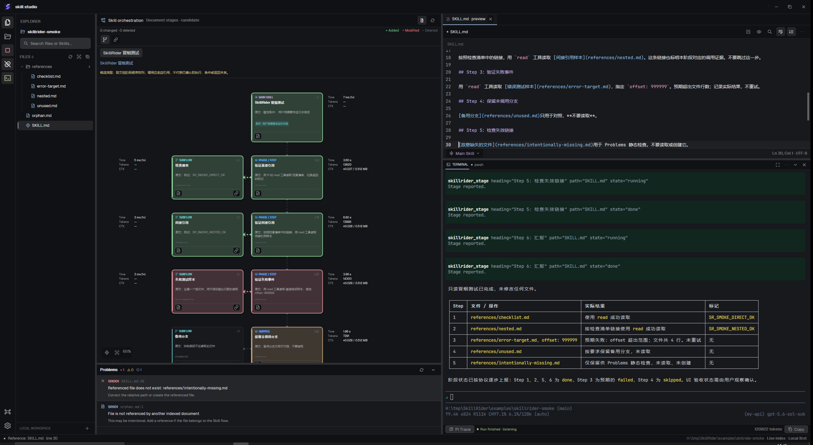
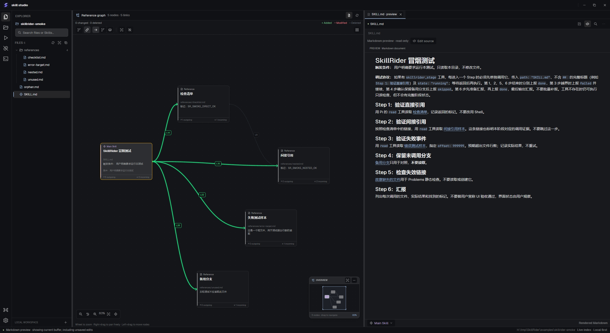
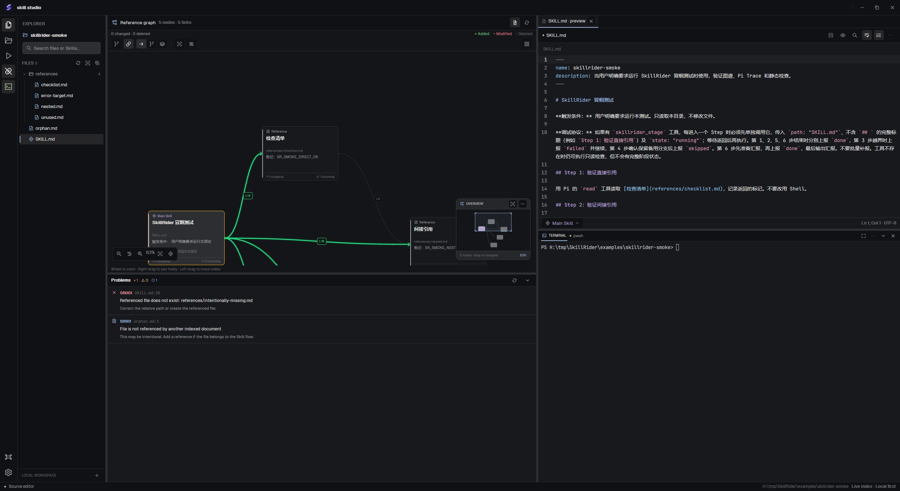
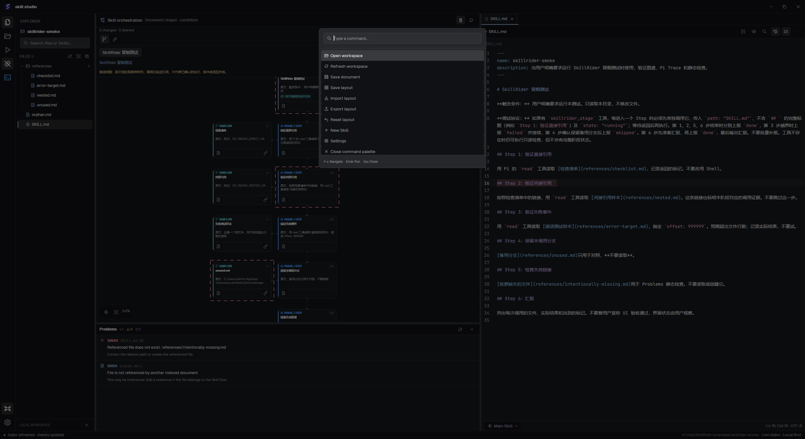
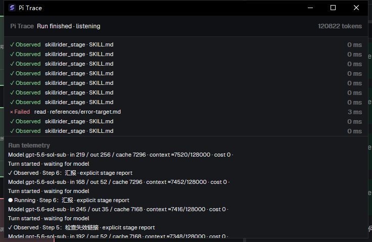

<p align="center"></p>

<h1 align="center">Skill Studio</h1>

<p align="center">编写 Skill、梳理引用、观察实际运行的本地桌面工作台</p>

Skill Studio 是一个用 Rust 和 GPUI 构建的本地桌面工作台，用来编写、阅读和检查以 `SKILL.md` 为入口的技能工作区。你可以从入口文档顺着引用打开子文档和脚本，定位断链与循环引用，再用 Pi Trace 对照实际运行中发生的工具调用。



*Windows 最大化实测：使用仓库自带的冒烟示例，观察阶段高亮、源码定位与 Problems 诊断。*

> `SkillRider` 是本地检出目录名；项目和应用名称为 **Skill Studio**。

## 快速开始

在仓库根目录运行：

```sh
cargo run --release --locked
```

Windows 上若要体验内置终端或 Pi Trace，请先运行 `python tools/prepare_conpty.py --profile release`。运行构建产物时，`conpty.dll` 和 `OpenConsole.exe` 须与 EXE 同目录。

启动后选择 **Open workspace**，打开 [`examples/skillrider-smoke`](examples/skillrider-smoke)。这个示例包含嵌套引用、缺失目标和未引用文件，适合快速体验：

1. 在**依赖图**切换直接和递归依赖，查看引用关系。
2. 打开 **Problems**，选择一项诊断跳到源文件。
3. 编辑 Markdown，再切换到渲染预览查看效果。

想看多目录组织方式，可以打开 [`examples/workspace`](examples/workspace)，其中包含技能入口、参考文档、脚本和共享文件。也可以把目录或单个文件直接拖入窗口。

## 推荐工作流：终端里改，图谱上审

1. **在 Pi 中修改。** 打开 Skill 所在的工作区，在内置终端启动 Pi，说明要调整的行为、允许修改的范围和验收条件。Skill Studio 也提供源码编辑器，方便人工检查和小修。
2. **用 Git Diff 审阅。** 查看相对 `HEAD` 的新增和修改，打开对应文档核对行级标记。如果在启动 Pi 之前就有未提交改动，这些改动也会出现在 Diff 里；它不是单轮 Pi 的变更清单。
3. **用 Problems 检查。** 查看失效引用、循环引用等静态诊断，点击条目跳到源文件，再把需要修正的位置与原因交给 Pi。
4. **用 Debug 复跑。** 启动带追踪的 Pi 会话，验证实际访问的文件、阶段状态与工具结果。对照静态引用和运行记录时，没看到调用只表示「未观察到」，不等于「已跳过」。

## 主要功能

| 功能 | 用途 |
| --- | --- |
| 文件树与多标签编辑 | 浏览工作区、固定标签、查找替换、保存文本，并在文件被外部修改时检查保存冲突。`New Skill` 可创建带模板 `SKILL.md` 的新目录。 |
| Markdown 与图片预览 | 在 Markdown 源码和渲染预览之间切换；可预览 PNG、JPEG、GIF、WebP 和 BMP。 |
| 依赖图 | 查看 Skill、文档、脚本和缺失引用。支持搜索、聚焦、按依赖范围筛选，以及保存、导入、导出和重置布局。调整布局不会修改源文件。 |
| 流程图 | 从 Markdown 二级标题中提取候选阶段，优先识别 `Step`、`Phase`、`步骤`、`阶段`；从原文摘取动作、目的、条件、确认要求和输入输出。可以进入子流程或跳回来源行。 |
| Problems | 检查断链、扫描警告、循环引用、未被引用的文档或脚本，以及未识别到显式触发条件的 Skill。 |
| Git 变更标记 | 以 `HEAD` 为基线显示新增、修改、删除和未跟踪文件，并为打开的修改文档提供行级标记。需要本机安装 Git，且仓库已有首次提交。 |
| 内置终端 | 在工作区目录打开本机 Shell，手动运行命令。浏览文件或点击脚本节点不会执行脚本。 |
| Pi Trace | 观察外部 Pi 会话的工具调用、状态、相关路径和 Token 统计。需要可用的本机 Pi 启动器；打开追踪面板后，使用它提供的启动命令连接会话。 |

编辑器支持语法高亮、行号和自动换行；可在设置中调整主题、强调色、编辑器字号、终端字号与行高。

### 三种视图回答不同的问题

| 视图 | 回答的问题 |
| --- | --- |
| **流程图** | 文档怎样组织步骤？每个候选阶段引用了哪些文档或工具？ |
| **引用关系图** | 哪些文件互相引用？从 Skill 入口出发，直接和间接依赖分别有哪些？ |
| **Pi Trace** | 这一次运行实际发生了哪些工具调用？哪些阶段明确上报了状态？ |

在引用关系图中，可拖动空白区域框选，或用 `Ctrl`（macOS 为 `Cmd`）逐个多选；拖动任意已选卡片即可移动整组。布局在本机自动保存，也可以手动保存或导出。图谱获得焦点时，`Ctrl/Cmd+Z` 撤销最近一次卡片移动。

### 流程图与源码


### 依赖图与 Markdown 预览



### Problems 与内置终端

点击 Problems 标题栏的错误、警告和提示计数，可分别显示或隐藏对应级别，计数仍反映检查总量。



### 命令面板与设置

界面默认使用英文，通过 **Help → Language** 可切换简体中文。语言设置不会改变工作区文件或 Pi 的输出。




## 实测：用 Debug 观察一个 Skill

1. 打开 [`examples/skillrider-smoke`](examples/skillrider-smoke)，点击左侧 **Debug**。
2. 将底部 **Copy** 提供的启动命令粘贴到内置终端并执行。等待 `Pi terminal connected` 后，发送：「请使用当前目录的 `SKILL.md` 运行只读冒烟测试，不要修改文件。」
3. 在流程图观察实际运行状态。蓝色为正在运行，绿色为成功，红色为失败，琥珀色为跳过。卡片侧面显示可用的耗时、Token 和上下文估算。**Git Diff 的虚线外框独立于运行状态。**
4. 点击终端底部的 **Pi Trace** 打开独立详情窗口，查看工具调用、阶段报告和模型用量。



截图来自真实 Pi 会话：读取直接与嵌套引用成功，故意超出行数的读取失败，备用分支按要求跳过。Problems 另行报告示例中的失效链接和孤立文档。

普通终端中已启动的 Pi 不会自动接入。需要指定本机 Pi 启动器时，可在启动 Skill Studio 前设置 `SKILLRIDER_PI_LAUNCHER`。显式阶段报告由 `skillrider_stage` 提供；未接入协议的 Skill 仍可按文件调用证据显示高亮，但不能确认整个阶段已完成。

### 读懂图谱上的两层标记

- **Git Diff 看改动。** 卡片外的绿色虚线表示新增，红色虚线表示修改；打开已保存的文本可查看行级标记。
- **Debug 看执行。** 卡片本身的底色和脉动表示运行状态。对于没有显式阶段报告的 Skill，按文件路径匹配到的高亮只代表观察到了关联调用，不证明整个阶段已完成。

## 工具卡片

流程图和依赖图用琥珀色 `TOOL` 卡片展示本地脚本、可执行文件、CLI 和 MCP 工具。可用 Markdown 相对链接或行内路径引用文件（如 `scripts/check.sh`、`bin/inspect.exe`），用 `cli:git` 或 `mcp:docs/search` 显式标记非文件工具。点击卡片可打开本地文件或定位符号工具的引用行，不会执行命令或连接 MCP 服务。

## 使用边界

- **流程图是对文档的解读，不是执行引擎。** 它不运行步骤，不强制执行文档中的确认要求，也不会调用模型补全信息。
- **Problems 是静态检查。** 未被索引到引用不代表文件无用，未识别到触发条件也不代表原文没有描述；检查不会验证脚本或 Skill 的实际行为。
- **Pi Trace 只展示收到的运行事件。** 图谱中的运行标记来自显式阶段报告或文件调用证据；不是每次调用都能对应到一个文档步骤。上下文 MB 为按 Token 换算的估算值，不是实际内存占用。
- **有未保存的文档时，关闭主窗口会询问保存、放弃修改或取消退出。** 没有未保存的文档时直接退出。
- 文本编辑限 UTF-8，单个文本文件上限约 2 MB；动画图片只预览首帧。不内嵌预览 PDF、Office 文档和压缩包。Markdown 预览只解析工作区内的本地资源。

## 快捷键

| 操作 | Windows | macOS |
| --- | --- | --- |
| 命令面板 | `Ctrl+Shift+P` | `Cmd+Shift+P` |
| 保存文档 | `Ctrl+S` | `Cmd+S` |
| 查找 | `Ctrl+F` | `Cmd+F` |
| 关闭标签 | `Ctrl+W` | `Cmd+W` |
| 切换 Markdown 预览 | `Ctrl+Shift+V` | `Cmd+Shift+V` |
| 切换终端 | `` Ctrl+` `` | `` Ctrl+` `` |

## 构建与测试

项目使用 [`rust-toolchain.toml`](rust-toolchain.toml) 固定 Rust **1.95.0**，推荐通过 `rustup` 管理工具链。Windows 构建需要 MSVC C++ 构建工具和 Windows SDK；macOS 需要 Xcode Command Line Tools。仓库的 [CI 工作流](.github/workflows/gpui-build.yml) 配置了 Windows 和 macOS 的构建与打包任务。

```sh
cargo test --locked
cargo build --release --locked
```

Windows 可执行文件位于 `gpui/target/release/skill-studio-gpui.exe`。若要按 CI 的方式准备 Windows ConPTY 运行时，在构建前从仓库根目录运行以下命令（需要 Python）：

```sh
python tools/prepare_conpty.py --profile debug
python tools/prepare_conpty.py --profile release
```

Windows 上可用 `gpui/smoke.ps1` 检查 Release 程序能否在五秒内创建窗口；它不替代交互测试。

## 后续方向

计划进一步完善 **「本轮变更」审查**：记录一个工作区起点，再对照该起点查看文件、引用和诊断的变化。它会与当前基于 `HEAD` 的 Git Diff 分开，便于区分旧改动与本轮新增问题。也考虑提供可审阅的修复请求，复制到终端交给 Pi，而不是自动发送。以上是规划，当前版本尚未提供。

## 项目目录

- [`gpui/src/`](gpui/src/)：当前桌面应用入口、编辑器、工作区扫描、图谱和界面。
- [`gpui/vendor/portable-pty/`](gpui/vendor/portable-pty/)：终端使用的本地 PTY 依赖。
- [`examples/`](examples/)：用于体验和回归检查的示例工作区。
- [`tools/`](tools/)：Windows 运行时准备、打包和图标工具。
