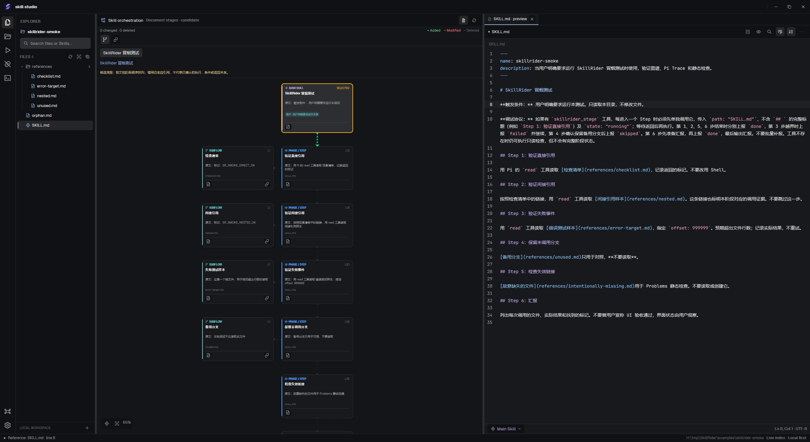
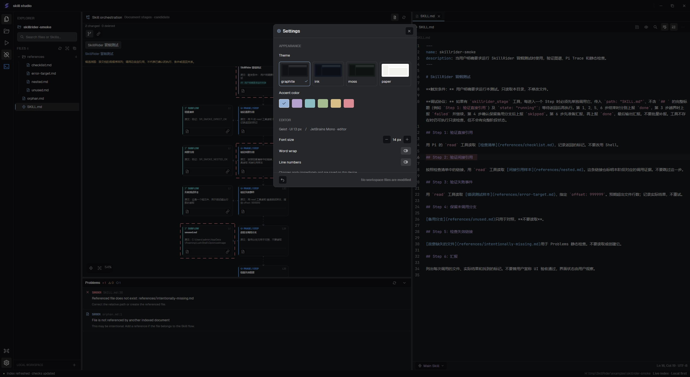

<p align="center"></p>

<h1 align="center">Skill Studio</h1>

<p align="center">围绕 <code>Pi</code> 构建的 Agent-in-the-Loop Skill 上下文工程与可视化工作台</p>

Skill Studio 是一个用 Rust 和 GPUI 构建的本地高性能桌面工作台，专为以 `SKILL.md` 为核心的 AI Agent 技能工程设计。它不再只是静态的 Markdown 流程图查看器，而是作为 **`Pi` 编码智能体的可视化指挥中心（Context Budget Map + 静态/动态诊断 + 一键 Pi 指令派发 + Git HEAD 瘦身收益验证）**，帮助你洞察 Progressive Disclosure（渐进式披露）的三级上下文开销、消除触发词冲突、定位运行期漏读引用，并驱动内置 `Pi` 终端完成精准重构。


*Windows 最大化实测：展示上下文预算热力图（Context Budget Map）、源码定位、Problems 诊断与内置 Pi 终端联动。*

> `SkillRider` 是本地检出目录名；项目和应用名称为 **Skill Studio**。

## 快速开始

在仓库根目录运行：

```sh
cargo run --release --locked
```

Windows 上若要体验内置终端或 Pi Trace，请先运行 `python tools/prepare_conpty.py --profile release`。运行构建产物时，`conpty.dll` 和 `OpenConsole.exe` 须与 EXE 同目录。

启动后选择 **Open workspace**，打开 [`examples/skillrider-smoke`](examples/skillrider-smoke)。这个示例包含嵌套引用、缺失目标和未引用文件，适合快速体验：

1. 在**依赖图**切换直接和递归依赖，查看引用关系。
2. 打开 **Problems**，选择一项诊断跳到源文件。
3. 编辑 Markdown，再切换到渲染预览查看效果。

想看多目录组织方式，可以打开 [`examples/workspace`](examples/workspace)，其中包含技能入口、参考文档、脚本和共享文件。也可以把目录或单个文件直接拖入窗口。

## 推荐工作流：Agent-in-the-Loop（图谱洞察 → 一键派发 Pi → 实时验证）

因为开发者本身就在使用 `Pi` 编写与维护 Skill，Skill Studio 的定位不是用死板的规则脚本去替代大模型，而是提供 **`Pi` 在终端里看不到的全局上下文热力与运行期盲区**：

1. **看热力：审视 L0 / L1 / L2 上下文预算（Context Budget Map）。**
   - **L0（Frontmatter）**：常驻系统提示词开销（>250 tok 告警）。当打开多 Skill 目录（如 `~/.agents/skills`）时，顶部自动汇总全局 `∑N skills · L0 X.Xk tok`。
   - **L1（Body & Sections）**：Skill 触发后载入的章节主轴。每张章节卡片内置全圆角胶囊进度条、Token 占比（`%`）与代码块开销（`code tok`），并按 `Light` / `Normal` / `Heavy` / `Bloated` 四级热力着色。
   - **L2（References & Scripts）**：按需懒加载的外部引用文件与工具脚本，统计延迟加载率（`% lazy`）。
2. **一键派发：从重型卡片或诊断项直接驱动 `Pi`（`✦ Slim` / `✦ Fix with Pi`）。**
   - 在 ≥350 tokens 的重型章节卡片上点击 **`✦ Slim`（`✦ 瘦身`）**，或在超重入口卡片上点击 **`✦ Slim Skill`**，工作台会自动展开内置终端与 `Pi Trace`，将包含精确文件路径、行号、Token 数和拆分要求的 Prompt 安全填入 `Pi` 终端（同时复制到剪贴板，留给你按回车确认执行）。
   - 在 **Problems** 面板点击任意诊断项（`SR001`–`SR404`）右侧的 **`✦ Fix with Pi`（`✦ Pi 修复`）**，一键派发针对性的修复指令（如断链修复、循环引用解耦、L0 描述精简、多 Skill 触发边界厘清）。
3. **跑评测：用 `▶ Eval with Pi` 与 `Pi Trace` 捕获「漏读引用」。**
   - 点击画布顶部预算栏的 **`▶ Eval with Pi`（`▶ Pi 评测`）**，让 `Pi` 模拟真实用户请求执行干跑评测并上报 `skillrider_stage`。
   - 若运行中发生工具调用报错，且关联的 `REFERENCE` 卡片未被 `read`（Missed Reference），该引用卡片会自动高亮琥珀色边框并出现 **`⚠ Missed · Fix`（`⚠ 漏读 · 修复`）** 按钮，一键指示 `Pi` 强化原文档引用处的必读路由条件。
4. **验收益：对照 Git `HEAD` 实时查看瘦身净收益（Token Delta）。**
   - `Pi` 修改并保存文档后，无需离开画布，顶部标题胶囊、`L0`、`L1` 以及主入口卡片会自动计算并显示相对 `HEAD` 的 Token 净增减与百分比（如 `HEAD -1.2k -42%`，瘦身显示翠绿色，膨胀显示琥珀色），配合卡片外的 Git Diff 虚线框直观验收重构效果。

## 主要功能

| 功能 | 用途 |
| --- | --- |
| **上下文预算热力图 (Context Budget Map)** | 保留文档全部 `## H2` 章节，按 L0/L1/L2 渐进式披露模型计算 Token 权重与代码块占比；支持四级热力着色、全圆角胶囊进度条、多列级联扇出布局、双击下钻子文档与面包屑回退。打开文件夹工作区时右侧自动预览入口 `SKILL.md`。 |
| **一键 Pi 协同桥 (Pi Dispatch Bridge)** | 在重型章节卡片（`✦ Slim`）、主入口卡片（`✦ Slim Skill`）、顶部评测栏（`▶ Eval with Pi`）、漏读引用卡片（`⚠ Missed · Fix`）及 Problems 诊断行（`✦ Fix with Pi`）一键唤醒内置终端并注入结构化 `Pi` 指令。 |
| **Problems 静态与架构审计** | 涵盖断链（`SR001`）、扫描警告（`SR002`）、孤立文档（`SR101`）、循环引用（`SR201`）、缺失触发条件（`SR301`）、L0 预算超标（`SR401`）、L1 正文过重（`SR402`）、重型内联章节未拆分（`SR403`）及**多 Skill 触发词冲突检测（`SR404`）**。 |
| **Git `HEAD` 变更与 Token Delta** | 以 `HEAD` 为基线显示新增、修改、删除文件与编辑器行级高亮，并实时对比 `HEAD` 版本的 L0/L1/Total Token 增减幅度（`Δ-X.Xk -XX%`）。 |
| **依赖图 (Reference Graph)** | 查看 Skill、文档、脚本和缺失引用。支持搜索、聚焦、按依赖范围筛选，以及保存、导入、导出和重置布局。调整布局不会修改源文件。 |
| **文件树与多标签编辑** | 浏览工作区、固定标签、查找替换、保存文本，并在文件被外部修改时检查保存冲突。`New Skill` 可创建带模板 `SKILL.md` 的新目录。 |
| **Markdown 与图片预览** | 在 Markdown 源码和渲染预览之间切换；可预览 PNG、JPEG、GIF、WebP 和 BMP。 |
| **内置终端与 Pi Trace** | 在工作区目录打开本机 PTY Shell；通过 UDP 桥接实时观察 `Pi` 会话的工具调用、耗时、Token 消耗、阶段状态与漏读引用告警。 |

编辑器支持语法高亮、行号和自动换行；可在设置中调整主题、强调色、编辑器字号、终端字号与行高。

### 三种视图回答不同的问题

| 视图 | 回答的问题 |
| --- | --- |
| **上下文预算热力图 (Context Budget Map)** | 这个 Skill 吃掉了多少 L0/L1/L2 上下文？哪些章节过于臃肿需要让 `Pi` 拆分为按需引用？ |
| **引用关系图 (Reference Graph)** | 哪些文件互相引用？从 Skill 入口出发，直接和间接依赖分别有哪些？是否存在孤立文件或循环依赖？ |
| **Pi Trace 运行追踪** | 这一次 `Pi` 运行实际读取了哪些引用文件？有没有工具报错是因为跳过了某个关键 `references/*.md`？ |

在引用关系图中，可拖动空白区域框选，或用 `Ctrl`（macOS 为 `Cmd`）逐个多选；拖动任意已选卡片即可移动整组。布局在本机自动保存，也可以手动保存或导出。图谱获得焦点时，`Ctrl/Cmd+Z` 撤销最近一次卡片移动。

### 流程图与源码



### 依赖图与 Markdown 预览


### Problems 与内置终端

点击 Problems 标题栏的错误、警告和提示计数，可分别显示或隐藏对应级别，计数仍反映检查总量。


### 命令面板与设置

界面默认使用英文，通过 **Help → Language** 可切换简体中文。语言设置不会改变工作区文件或 Pi 的输出。




## 实测：用 Debug 观察一个 Skill

1. 打开 [`examples/skillrider-smoke`](examples/skillrider-smoke)，点击左侧 **Debug**。
2. 将底部 **Copy** 提供的启动命令粘贴到内置终端并执行。等待 `Pi terminal connected` 后，发送：「请使用当前目录的 `SKILL.md` 运行只读冒烟测试，不要修改文件。」
3. 在流程图观察实际运行状态。蓝色为正在运行，绿色为成功，红色为失败，琥珀色为跳过。卡片侧面显示可用的耗时、Token 和上下文估算。**Git Diff 的虚线外框独立于运行状态。**
4. 点击终端底部的 **Pi Trace** 打开独立详情窗口，查看工具调用、阶段报告和模型用量。


截图来自真实 Pi 会话：读取直接与嵌套引用成功，故意超出行数的读取失败，备用分支按要求跳过。Problems 另行报告示例中的失效链接和孤立文档。

普通终端中已启动的 Pi 不会自动接入。需要指定本机 Pi 启动器时，可在启动 Skill Studio 前设置 `SKILLRIDER_PI_LAUNCHER`。显式阶段报告由 `skillrider_stage` 提供；未接入协议的 Skill 仍可按文件调用证据显示高亮，但不能确认整个阶段已完成。

### 读懂图谱上的两层标记

- **Git Diff 看改动。** 卡片外的绿色虚线表示新增，红色虚线表示修改；打开已保存的文本可查看行级标记。
- **Debug 看执行。** 卡片本身的底色和脉动表示运行状态。对于没有显式阶段报告的 Skill，按文件路径匹配到的高亮只代表观察到了关联调用，不证明整个阶段已完成。

## 工具卡片

流程图和依赖图用琥珀色 `TOOL` 卡片展示本地脚本、可执行文件、CLI 和 MCP 工具。可用 Markdown 相对链接或行内路径引用文件（如 `scripts/check.sh`、`bin/inspect.exe`），用 `cli:git` 或 `mcp:docs/search` 显式标记非文件工具。点击卡片可打开本地文件或定位符号工具的引用行，不会执行命令或连接 MCP 服务。

## 使用边界

- **流程图是对文档的解读，不是执行引擎。** 它不运行步骤，不强制执行文档中的确认要求，也不会调用模型补全信息。
- **Problems 是静态检查。** 未被索引到引用不代表文件无用，未识别到触发条件也不代表原文没有描述；检查不会验证脚本或 Skill 的实际行为。
- **Pi Trace 只展示收到的运行事件。** 图谱中的运行标记来自显式阶段报告或文件调用证据；不是每次调用都能对应到一个文档步骤。上下文 MB 为按 Token 换算的估算值，不是实际内存占用。
- **有未保存的文档时，关闭主窗口会询问保存、放弃修改或取消退出。** 没有未保存的文档时直接退出。
- 文本编辑限 UTF-8，单个文本文件上限约 2 MB；动画图片只预览首帧。不内嵌预览 PDF、Office 文档和压缩包。Markdown 预览只解析工作区内的本地资源。

## 快捷键

| 操作 | Windows | macOS |
| --- | --- | --- |
| 命令面板 | `Ctrl+Shift+P` | `Cmd+Shift+P` |
| 保存文档 | `Ctrl+S` | `Cmd+S` |
| 查找 | `Ctrl+F` | `Cmd+F` |
| 关闭标签 | `Ctrl+W` | `Cmd+W` |
| 切换 Markdown 预览 | `Ctrl+Shift+V` | `Cmd+Shift+V` |
| 切换终端 | `` Ctrl+` `` | `` Ctrl+` `` |

## 构建与测试

项目使用 [`rust-toolchain.toml`](rust-toolchain.toml) 固定 Rust **1.95.0**，推荐通过 `rustup` 管理工具链。Windows 构建需要 MSVC C++ 构建工具和 Windows SDK；macOS 需要 Xcode Command Line Tools。仓库的 [CI 工作流](.github/workflows/gpui-build.yml) 配置了 Windows 和 macOS 的构建与打包任务。

```sh
cargo test --locked
cargo build --release --locked
```

Windows 可执行文件位于 `gpui/target/release/skill-studio-gpui.exe`。若要按 CI 的方式准备 Windows ConPTY 运行时，在构建前从仓库根目录运行以下命令（需要 Python）：

```sh
python tools/prepare_conpty.py --profile debug
python tools/prepare_conpty.py --profile release
```

Windows 上可用 `gpui/smoke.ps1` 检查 Release 程序能否在五秒内创建窗口；它不替代交互测试。

## 改造计划与路线图 (TODO / Roadmap)

围绕 **「打造不可替代的 Agent-in-the-Loop Skill 工程工作台」**，我们的改造计划分为已完成基座与后续演进方向：

### Phase 1：上下文预算热力图与高帧率现代卡片 UI（已完成 ✅）
- [x] **L0 / L1 / L2 渐进式披露预算建模**：实现 CJK + ASCII 混合 Token 估算器（`core::estimate_tokens`），完整保留全部 `## H2` 章节，计算每节 Token、代码块 Token（`code_tokens`）、文档占比（`share`）及可达引用懒加载池（`ref_tokens` / `% lazy`）。
- [x] **高颜值现代卡片与纯线性缩放**：内置全圆角胶囊进度条（`rounded(px(999.))`）、热力染色引用跳转胶囊（`↗ 引用 Lxx`）、四级热力色阶（Light / Normal / Heavy / Bloated），移除缩放最小字号钳制以彻底解决缩小视图时的文字挤压重叠。
- [x] **60fps 视口裁剪与渲染加速**：针对大型 Skill（如 `lark-base`）实现屏幕视口裁剪（Viewport Culling）、非高亮边正交快速绘制（`paint_quad`）与按需阴影，大幅降低 GPU 负载。
- [x] **开箱即用体验优化**：打开文件夹工作区时自动选中并预览入口 `SKILL.md`；过滤 ASCII 表格/树形框线噪声，提取列表项生成干净的章节语义摘要。

### Phase 2：Agent-in-the-Loop `Pi` 协同闭环（已完成 ✅）
- [x] **Pi Dispatch Bridge（一键派发）**：打通画布卡片（`✦ Slim` / `✦ Slim Skill`）、顶部评测栏（`▶ Eval with Pi`）与 Problems 面板（`✦ Fix with Pi`）到内置 `TerminalView` 的安全指令注入。
- [x] **Git `HEAD` Before/After Token Delta**：在 `git_diff` 中解析 `HEAD` 版本文档预算，在顶部 `L0`/`L1`/标题栏与主卡片实时展示 `Pi` 重构后的 Token 净节省量与百分比。
- [x] **多 Skill 全局 L0 汇总与触发冲突审计（`SR404`）**：支持打开多 Skill 父目录时汇总全局 L0 常驻开销，并检测不同 Skill 间的 YAML `description` 触发词高重合冲突。
- [x] **Live Eval 漏读引用诊断（`⚠ Missed · Fix`）**：结合 `Pi Trace` 实时工具报错与文件读取证据，自动高亮未被读取的关联 `REFERENCE` 卡片并支持一键让 `Pi` 强化路由条件。

### Phase 3：深度评测、会话快照与工作流进阶（待演进 TODO 📋）
- [ ] **「本轮会话起点」独立基线对比（Session Snapshot vs. Git `HEAD`）**
  - 记录打开工作区或发起一轮 `Pi` 派发前的内存快照作为「本轮起点」，与基于 `HEAD` 的 Git Diff 区分开，精准衡量**单次 `Pi` 对话**带来的文件改动、引用增减、诊断消除数量与 Token 变化。
- [ ] **Skill 触发路由沙盒（Trigger Router Sandbox）**
  - 在多 Skill 工作区提供轻量测试输入框：输入任意用户自然语言请求，实时高亮命中率最高的候选 Skill、展示匹配到的正/负向关键词证据，并对边界模糊的 Skill 组合一键派发 `Pi` 调优。
- [ ] **多轮 `Pi Trace` 历史对比与冷门重章节画像（Cold Heavy Section Profiler）**
  - 持久化最近 N 次 `Pi` 调试/评测运行记录，统计跨多次运行从未被 `read` 的参考文档（Dead References）或长期占满 L1 却从不触发子调用的重型章节，给出高置信度的归档/拆分建议。
- [ ] **交互式拆分预览与一键引用重连（Interactive Reference Extraction）**
  - 当 `Pi` 将大段内联内容拆分为 `references/*.md` 时，在图谱上提供拆分前后的子图动画过渡与断链自动巡检。
- [ ] **Skill 规范模板库与导出检查单（Skill Linter & Release Checklist）**
  - 支持自定义团队级预算阈值（如自定义 L0/L1 上限），并在发布/提交前生成结构化的 Skill 健壮度评分报告。

## 项目目录

- [`gpui/src/`](gpui/src/)：当前桌面应用入口、编辑器、工作区扫描、图谱和界面。
- [`gpui/vendor/portable-pty/`](gpui/vendor/portable-pty/)：终端使用的本地 PTY 依赖。
- [`examples/`](examples/)：用于体验和回归检查的示例工作区。
- [`tools/`](tools/)：Windows 运行时准备、打包和图标工具。
